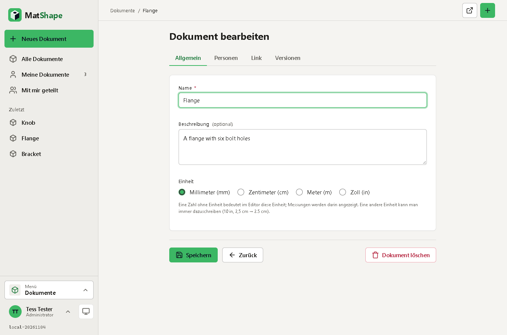
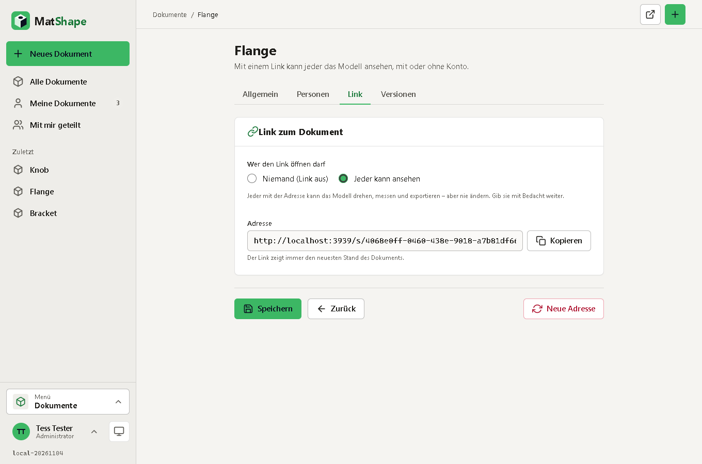

<div align="center">


# MatShape

**3D-CAD im Browser – parametrische Teile aus Skizzen und Features, im Stil der CAD-Werkzeuge im Web, aber selbst gehostet.**

Ein App-Container und PostgreSQL. Port **3939**.

</div>


---

## Auf einen Blick

**Modellieren**
- **Dokumente** mit mehreren **Part Studios** (Tabs am unteren Rand: anlegen, umbenennen, duplizieren, verschieben, löschen)
- **Skizzen** auf den Ebenen Oben/Vorne/Rechts, auf versetzten Ebenen oder direkt auf **ebenen Flächen** eines Teils: Linie (als Linienzug), Rechteck, Mittelpunkt-Rechteck, Kreis, 3-Punkt-Bogen, Polygon, Punkt, **Konstruktionsgeometrie**
- Fangen an Endpunkten, Mittelpunkten, Kantenmitten und am Raster, waagerecht/senkrecht-Einrasten, Enden und ganze Formen ziehen (verbundene Enden bleiben zusammen), **exakte Maße** im Panel
- **Features**: Extrudieren (Blind, Symmetrisch, Durch alles; Neu / Hinzufügen / Entfernen / Schnittmenge), Rotieren (um Skizzenachse oder Linie), Boolesch (Vereinigen, Abziehen, Schnittmenge), Verschieben/Drehen/Kopieren, Spiegeln, Lineares Muster, Kreismuster, Teilen an einer Ebene, Teil löschen, Ebene (versetzt), **Variable**
- Jedes Feld nimmt **Ausdrücke mit Einheiten**: `25`, `2.5 cm`, `1 in`, `#d / 8`, `sqrt(#a^2 + #b^2)`, `30 deg` – eine Variable ändern, das Modell folgt
- **Feature-Historie**: bearbeiten (Doppelklick), umbenennen, unterdrücken, verschieben, löschen, **Rollback-Leiste**; Live-Vorschau während des Bearbeitens; Fehler stehen am Feature
- **Skizzen mit Bedingungen wie bei OnShape:** Zeichnen setzt die naheliegenden Bedingungen selbst (Rechteck = 4 Linien mit H/V, gefangene Punkte deckungsgleich); Bedingungen Deckungsgleich (I), Horizontal (H), Vertikal (V), Parallel, Rechtwinklig, Tangential, Gleich, Mittelpunkt, Konzentrisch, Fixieren – als Symbole an den Elementen. **Bemaßung (D):** zwei Punkte, Punkt + Linie, zwei Linien (Abstand oder Winkel) oder eine Linie/ein Kreis/Bogen anklicken, Wert eintippen – auch mit Variablen (`#breite`). Farben: **blau** = noch frei, **schwarz** = voll bestimmt, **rot** = Widerspruch; widersprüchliche Bedingungen stehen in der Skizzen-Box (und als Warnung im Feature-Baum) und werden nicht angewendet
- **Tastenkürzel wie bei OnShape**: Umschalt+S/E/W, Umschalt+1…7 Ansichten, Pfeiltasten drehen (Umschalt: 90°), P Ebenen, N Draufsicht, L/G/C/A/D/Q/H/V in der Skizze, **?** zeigt alle
- **Rückgängig / Wiederholen** (Strg+Z / Strg+Y); kompakter Skizzen-Dialog (eine Zeile, Felder erst bei Auswahl, einklappbar)
- Geometriekern: **[Manifold](https://github.com/elalish/manifold)** (WebAssembly, robuste Boolesche Operationen), Darstellung: **[three.js](https://threejs.org)** – beides als Kopie im Projekt, kein CDN

**Ansehen, messen, ausgeben**
- **Ansichtswürfel** oben rechts wie bei OnShape: dreht sich mit der Ansicht, ein Klick auf Fläche, Kante oder Ecke dreht die Ansicht dorthin, Ziehen dreht das Modell, zwei Pfeile drehen um 90° um die Blickachse
- **Farbschemata der Ansicht**: Automatisch, Hoher Kontrast (dicke schwarze Linien), Dunkel, Blaupause – Kanten und Skizzenlinien mit echter Strichstärke
- Orthografische 3D-Ansicht mit Achsenkreuz, Isometrisch, Einpassen, schattiert / ohne Kanten / durchsichtig, Ebenen ein/aus
- Maus: Ziehen oder rechts Ziehen dreht, Mitte oder Umschalt+Ziehen verschiebt, Mausrad zoomt zum Zeiger; **Touch**: ein Finger dreht, zwei verschieben und zoomen
- **Teile** benennen, einfärben, ausblenden, isolieren; **Masseeigenschaften** (Volumen, Oberfläche, Größe); **Messen** von Abständen
- **Export**: **3MF mit Teilfarben** (für Slicer), STL (3D-Druck), OBJ, PNG der Ansicht, Part Studio als JSON; Teile per Klick auf das Farbfeld einfärben

**Zusammen arbeiten**
- **Teilen** mit Personen, die ein Konto haben – als *Bearbeiter* oder *Betrachter*, auf Wunsch mit E-Mail (MatSMTP) – oder per **Link** zum Ansehen (drehen, messen, exportieren; nie ändern)
- **Automatisches Speichern** mit Revisionsschutz: hat jemand anderes inzwischen gespeichert, wird nichts stillschweigend überschrieben (eigenen Stand behalten oder fremden laden); Änderungen anderer erscheinen von selbst
- **Versionen**: benannte Stände des ganzen Dokuments, schreibgeschützt öffnen, wiederherstellen (der Stand davor wird vorher gesichert)
- **Offline**: zuletzt geöffnete Dokumente bleiben verfügbar, Änderungen warten auf dem Gerät und werden bei Wiederverbindung gespeichert

**KI-Assistent**
- Im Editor der Knopf **KI**: beschreiben, was gebaut oder geändert werden soll („Platte 80 × 40 × 6 mit vier Bohrungen Ø 6“, „Mach die Hauptmaße zu Variablen“) – die KI legt **Features** an (Skizzen, Extrudieren, Muster …), die du wie eigene bearbeitest; die ganze Antwort ist **ein** Rückgängig-Schritt
- Bauen Features der Antwort nicht, schickt der Editor die Fehler selbst zur **Reparatur** zurück (einstellbar 0–5 Runden)
- **Profile** (*Administration → KI*): jeder **OpenAI-kompatible** Anbieter mit Schlüssel – **OpenAI**, **OpenRouter**, Mistral, DeepSeek, eigener Server – oder ein **ChatGPT-Konto** per Gerätecode (wie Codex). *Modelle laden* fragt den Anbieter; der Filter **Nur kostenlose Modelle** zeigt, was der Anbieter als kostenlos angibt (OpenRouter `:free` / Preis 0). *Testen*, *Aktivieren*, *Duplizieren*
- **Grenzen** gegen Kosten: Tokens je Person und Tag/Monat, für alle im Monat, Anfragen je Adresse und Minute, Antwortlänge, Wartezeit; **Hausregeln** für die KI; *Vollständige Anweisung anzeigen*
- **Läufe**: jede Anfrage mit allem, was gesendet und zurückgekommen ist, Tokens und Status; nach 180 Tagen gelöscht, im Datenexport enthalten, mit dem Konto gelöscht
- Schlüssel und ChatGPT-Anmeldung liegen **verschlüsselt im Datenvolume**, nie in der Datenbank, in einem Backup oder im Browser. Der Server prüft jede Antwort (bekannte Feature-Arten, eindeutige IDs, Größen) und das Bearbeiten-Recht

**Oberfläche**
- **Deutsch und Englisch**, **hell / dunkel**, Farbschemata (Standard, Papier, hoher Kontrast, OLED)
- Dokumentliste als **Bilder** (Vorschau des Modells) oder **Tabelle**, mit Suche, Filter und Sortierung
- **PWA**: installierbar (Android, iOS, Desktop), Safe Areas, kein ungewolltes Zoomen; am Smartphone wird die Feature-Liste zur Schublade
- **Deine Daten (DSGVO)**: alles als JSON herunterladen und das Konto endgültig löschen
- Design von [MatDesign](https://github.com/Real-TTX/MatDesign) (MatUi 0.9.3). Das erste Konto ist der Administrator

## Screenshots

| Skizze mit Linienzug und Bogen | Feature-Dialog mit Live-Vorschau |
|---|---|
|  |  |

| Messen | Dunkel |
|---|---|
|  |  |

| Dokumente | Versionen |
|---|---|
|  |  |

| Rotieren | Per Link ansehen |
|---|---|
|  |  |

| Dokument bearbeiten | Link teilen |
|---|---|
|  |  |

| KI-Assistent | KI-Profil mit Modellen (Nur kostenlose) |
|---|---|
|  |  |

| Smartphone | | |
|---|---|---|
|  |  |  |

## Starten

```bash
docker compose up -d                                       # Release (Branch main, Image :latest)
docker compose -f docker-compose.dev.yml up -d             # Development (Branch dev, Image :nightly) mit pgAdmin auf 3940
docker compose -f docker-compose.local.yml up -d --build   # lokal aus dem Quellcode, mit pgAdmin (3940) und Postgres auf 3941
```

Dann **http://localhost:3939** öffnen und registrieren – das erste Konto ist Administrator. Danach ist die Registrierung **geschlossen**: weitere Konten legt ein Administrator an (*Administration → Benutzer*), oder er öffnet die Registrierung (*Administration → System*).

| Datei | Branch | Image | Dienste |
|---|---|---|---|
| `docker-compose.yml` | main | `ghcr.io/real-ttx/matshape:latest` | web, db |
| `docker-compose.dev.yml` | dev | `ghcr.io/real-ttx/matshape:nightly` | web, db, pgadmin |
| `docker-compose.local.yml` | – | lokal gebaut (`matshape:local`) | web, db, pgadmin |

Jede Datei ist ein eigener Stack (`matshape`, `matshape-dev`, `matshape-local`). Volumes je Stack: `web-data` (Schlüssel der Sitzungen) und `db-data` (PostgreSQL 17), bei dev/local zusätzlich `pgadmin-data`. Die Compose-Dateien brauchen **keine** Variablen. Für den Betrieb im Internet das Datenbank-Passwort ändern und einen TLS-Proxy (Caddy, Traefik) davorsetzen, der `X-Forwarded-Proto` / `X-Forwarded-Host` setzt.

### Einstellungen (Umgebung)

Keine davon ist nötig; ohne sie läuft MatShape allein mit eigenen Konten und ohne E-Mails. **Mattiverse** setzt sie, wenn es MatShape installiert.

| Variable | Bedeutung |
|---|---|
| `ConnectionStrings__Default` | Verbindung zu PostgreSQL (Standard im Image: `Host=db;Database=matshape;Username=matshape;Password=matshape`) |
| `MAT_API_KEY` | Schlüssel für die Plattform-API `/api/*` (Header `X-Api-Key`) |
| `MATIDENTITY_AUTHORITY`, `MATIDENTITY_CLIENT_ID`, `MATIDENTITY_CLIENT_SECRET`, `MATIDENTITY_INTERNAL_URL` | Anmeldung über **MatIdentity** |
| `MATSMTP_HOST`, `MATSMTP_PORT`, `MATSMTP_USERNAME`, `MATSMTP_PASSWORD`, `MATSMTP_FROM`, `MATSMTP_TLS` | E-Mails über **MatSMTP** („Ein Dokument wurde mit dir geteilt“) |

## Plattform (Mattiverse, MatIdentity, MatSMTP)

MatShape erfüllt den Plattform-Vertrag der Mat-Apps ([MatDesign `docs/PLATFORM.md`](https://github.com/Real-TTX/MatDesign/blob/main/docs/PLATFORM.md), Paket MatPlatform 1.4.0 in `src/MatShape/MatPlatform`, eine Kopie).

| Endpunkt | Inhalt | Zugriff |
|---|---|---|
| `GET /api` | Beschreibung: Seiten *Übersicht* und *Einstellungen*, Kacheln, Felder, Schaltflächen, Rollen `admin`/`user` | anonym |
| `GET /api/health` | `ok` / `degraded` (kein aktiver Administrator) / `down` (Datenbank weg) | anonym |
| `GET /api/state[/{key}]` | Kacheln: aktive Benutzer, Dokumente, geteilte Dokumente, Dokumente mit Link, Part Studios, Versionen, geändert in 7 Tagen, Registrierung, letzte Änderung | Schlüssel oder Token |
| `GET`/`PUT /api/configure` | Registrierung offen, öffentliche Adresse | Schlüssel oder Token |
| `POST /api/actions/cleanUp` | beendete Sitzungen und vor über 30 Tagen gelöschte Dokumente endgültig entfernen | Schlüssel oder Token |

**Anmeldung über MatIdentity** (nur mit `MATIDENTITY_AUTHORITY`): OpenID Connect mit PKCE, Back-Channel-Logout unter `/signout-backchannel`. Lokale Anmeldung bleibt unter `/Account/Login?local=1` erreichbar. **E-Mails über MatSMTP** (nur mit `MATSMTP_HOST`): Benachrichtigung, wenn ein Dokument mit jemandem geteilt wird (abschaltbar im Profil).

## Entwicklung

- .NET 10, ASP.NET Core **Razor Pages**, EF Core + **PostgreSQL**, MatUi-Toolkit von MatDesign (kopiert nach `wwwroot/matui`)
- Der Editor ist JavaScript als ES-Module ohne Build-Schritt (`wwwroot/js/cad/*.js`); three.js und Manifold liegen als Kopie unter `wwwroot/lib` (Lizenzen daneben). Die Geometrie wird im Browser aus der Feature-Liste berechnet; der Server speichert und prüft die Feature-Liste (JSON) und entscheidet über die Rechte
- Geschäftslogik in statischen Klassen mit Rechteprüfung in jeder Funktion (`Services/Documents`, `Services/Accounts`); keine Datenbankabfragen in Seiten
- `dotnet build MatShape.slnx`, `dotnet test` – mit `MATSHAPE_TEST_DB` (z. B. `Host=localhost;Port=3941;Username=matshape;Password=matshape;Database=postgres`) laufen auch die Datenbank-Tests, jeder in einer eigenen Datenbank
- `./scripts/redeploy.ps1` baut den Container neu und startet den lokalen Stack (`-Clean` = leere Datenbank)
- Migrationen: `dotnet ef migrations add <Name> -p src/MatShape -o Data/Migrations` (werden beim Start angewendet)
- Texte: `src/MatShape/Resources/Texts/*.json` (`{"en": …, "de": …}`); Tests prüfen, dass jeder benutzte Schlüssel – auch die des Editors – in beiden Sprachen existiert
- Mehr zur Architektur in [CLAUDE.md](CLAUDE.md)

### Versionierung und Branches

| Branch | Kanal | Version | Image-Tags |
|---|---|---|---|
| `main` | Release | `0.1.<build>-<datum>` | `<version>`, `latest`, `release` |
| `dev` | Nightly | `nightly-<build>-<datum>` | `<version>`, `nightly` |
| andere / lokal | Local | `local-<datum>` | – |

Major/Minor stehen in `Directory.Build.props`; die GitHub Action `.github/workflows/build.yml` baut, testet und veröffentlicht die Images (amd64 + arm64) nach `ghcr.io/real-ttx/matshape`. Die Version steht unten im Menü und führt zur *Über*-Seite.

## Logo

| Favicon (16–32 px) | App-Icon | Maskable (PWA) | Logo hell | Logo dunkel | Einfarbig |
|---|---|---|---|---|---|
|  |  |  |  |  |  |

Ein isometrischer Block mit Bohrung und Bemaßung auf dem MatShape-Grün **#3CB764** – im Umfeld des typischen CAD-Grüns, aber etwas heller und gelblicher. Text auf dem Grün ist fast schwarz (7,3 : 1); Links und Akzenttext nutzen das dunklere **#1D7A3C** (im Dunkelmodus **#5FD384**). Das Favicon lässt Bemaßung und Lochwand weg, das Einfarbige ist nur Kontur.

Die Farbe muss noch in die Registry von MatDesign (`AppRegistry.cs`, `matui.apps.css`) eingetragen werden; bis dahin setzt `wwwroot/css/app.css` sie selbst.
